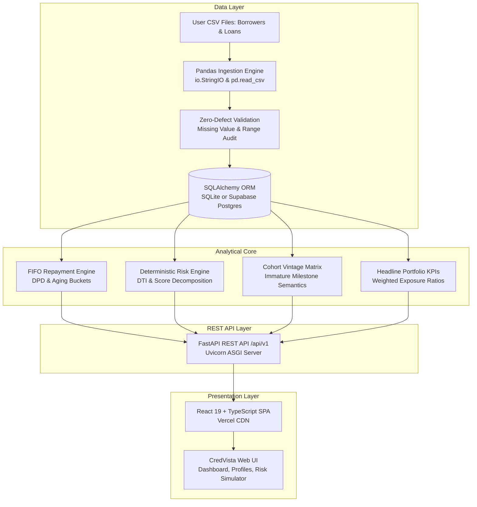
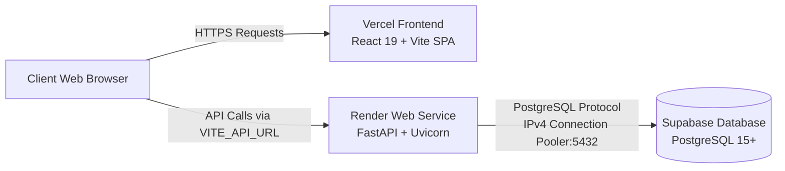

# CredVista — Technology Deep Dive & Architectural Guide

Welcome to the comprehensive technical documentation for **CredVista**, a production-grade Credit Risk & Loan Portfolio Intelligence Platform.

This document is crafted to give you a thorough, crystal-clear understanding of:
1. **What the project does from a financial domain perspective.**
2. **Which technologies and libraries are used, why they were chosen, and how their code operates.**
3. **Real code snippets directly from the codebase explaining how Pandas, NumPy/Math, SQLAlchemy, FastAPI, and React interact.**
4. **How the data flows from raw files to financial dashboards, risk models, and audit reports.**

---

## Table of Contents
- [1. Business & Domain Overview](#1-business--domain-overview)
- [2. Technology Stack Summary](#2-technology-stack-summary)
- [3. Deep Dive: Pandas in CredVista](#3-deep-dive-pandas-in-credvista)
- [4. Deep Dive: NumPy & Mathematical Modeling](#4-deep-dive-numpy--mathematical-modeling)
- [5. Deep Dive: SQLAlchemy & Database Layer](#5-deep-dive-sqlalchemy--database-layer)
- [6. Deep Dive: FastAPI & Pydantic](#6-deep-dive-fastapi--pydantic)
- [7. Deep Dive: React 19, TypeScript & Modern UI](#7-deep-dive-react-19-typescript--modern-ui)
- [8. Core Financial Algorithms Explained](#8-core-financial-algorithms-explained)
- [9. End-to-End System Architecture (Mermaid Diagram)](#9-end-to-end-system-architecture)
- [10. Cloud & Deployment Infrastructure](#10-cloud--deployment-infrastructure)

---

## 1. Business & Domain Overview

CredVista is an institutional credit-risk analytics engine. Financial institutions, neo-banks, and risk committees use CredVista to answer critical questions:
- **How much capital is currently exposed to default?**
- **Which loans are delinquent, and by how many days (Days Past Due - DPD)?**
- **How do borrower risk characteristics (Debt-to-Income ratio, FICO score, employment) translate to deterministic risk bands?**
- **How are loan cohorts deteriorating over time (Vintage / Cohort Analysis)?**
- **What happens to our balance sheet if we tighten risk policy thresholds (Policy Stress Simulator)?**

---

## 2. Technology Stack Summary

| Technology | Category | Purpose in CredVista | Primary Location in Codebase |
| :--- | :--- | :--- | :--- |
| **Python 3.11** | Core Language | High-performance backend runtime, type hints, numeric precision. | `backend/` |
| **Pandas** | Data Processing | CSV ingestion, data cleaning, type coercion, tabular exports, missing value detection (`pd.notna`). | `backend/app/ingestion/csv_importer.py`, `report_service.py` |
| **NumPy & Math** | Numerical Computation | Weighted averages, floating point rounding, vector calculations, ratio bounds. | `backend/app/services/portfolio_metrics.py`, `risk_rules.py` |
| **SQLAlchemy 2.0** | ORM & DB Engine | Relational mapping, schema constraints, ACID transactions, complex aggregations. | `backend/app/models/`, `backend/app/core/database.py` |
| **FastAPI** | REST API Framework | High-throughput asynchronous routing, Swagger documentation, dependency injection. | `backend/app/main.py`, `backend/app/api/routes/` |
| **Pydantic V2** | Schema & Validation | Request payload validation, settings management, serialization. | `backend/app/core/config.py` |
| **React 19 + TypeScript** | Frontend UI | Component architecture, state management, strict type safety. | `frontend/src/` |
| **Vite 6** | Build & Bundling | Lightning-fast HMR dev server and optimized production tree-shaking. | `frontend/vite.config.ts` |
| **PostgreSQL / Supabase** | Production DB | ACID-compliant cloud relational database with IPv4 connection pooling. | Cloud database |
| **SQLite** | Local / Fallback DB | Zero-configuration single-file database (`credvista.db`) for rapid local testing. | `credvista.db` |

---

## 3. Deep Dive: Pandas in CredVista

### Why Pandas?
When users upload custom portfolio datasets (Borrowers CSV and Loans CSV), the data arrives as raw text strings. Traditional parsing with Python's basic `csv` library is prone to type mismatch errors, silent failures on empty values, and slow loop performance. **Pandas (`pd`)** solves this with vectorized parsing, robust type coercion, and seamless memory conversion.

### Code Implementation in `backend/app/ingestion/csv_importer.py`:

```python
import io
import pandas as pd
from typing import Dict, Any
from sqlalchemy.orm import Session
from backend.app.models import Borrower, Loan

def import_portfolio_csvs(
    db: Session,
    borrowers_csv_content: str,
    loans_csv_content: str
) -> Dict[str, Any]:
    # 1. Using Pandas to parse raw string CSV stream into a DataFrame
    # io.StringIO converts the in-memory string into a file-like buffer
    df_b = pd.read_csv(io.StringIO(borrowers_csv_content))

    # 2. Extract tabular dictionary records for schema validation
    b_dicts = df_b.to_dict(orient="records")

    # 3. Clean and map data with Pandas' missing value detector: pd.notna()
    for row in b_dicts:
        b_id = str(row["borrower_id"]).strip()
        
        # pd.notna() checks if the cell is neither NaN, None, nor pd.NA
        # This prevents converting empty CSV cells into invalid "nan" floats
        annual_inc = float(row["annual_income"]) if pd.notna(row.get("annual_income")) else None
        credit_sc = int(row["credit_score"]) if pd.notna(row.get("credit_score")) else None
        monthly_debt = float(row["monthly_debt_obligations"]) if pd.notna(row.get("monthly_debt_obligations")) else None
        
        # Upsert into database
        ...
```

### Key Pandas Operations Used:
1. `pd.read_csv(io.StringIO(...))`:
   - Reads CSV data directly from HTTP multipart memory buffers without having to save temporary files to disk.
   - Automatically detects delimiters, column headers, and data types.
2. `df.to_dict(orient="records")`:
   - Transforms DataFrame rows into Python dictionary mappings: `[{"borrower_id": "B1", "annual_income": 75000}, ...]`.
   - Enables fast iteration and compatibility with Pydantic validation rules.
3. `pd.notna(value)`:
   - NumPy-backed check for missing / null / NaN values.
   - Crucial in credit risk to differentiate between a **0 income** vs **missing income (Unverified)**.

---

## 4. Deep Dive: NumPy & Mathematical Modeling

### Why NumPy & Vectorized Math?
Financial reporting requires calculating weighted averages, default frequencies, and delinquency metrics with strict precision. Floating-point imprecision or division-by-zero can invalidate risk reports.

### 1. Weighted Average Calculations (`backend/app/services/portfolio_metrics.py`)
In credit risk, a simple average of credit scores is misleading: a \$1,000,000 loan to a low-score borrower carries far more risk than a \$10,000 loan. We calculate **Weighted Average Credit Score** and **Weighted Average DTI** weighted by principal exposure:

$$\text{Weighted Average} = \frac{\sum (\text{Metric}_i \times \text{Principal}_i)}{\sum \text{Principal}_i}$$

```python
# Weighted Average Credit Score calculation
total_weight = 0.0
weighted_score_sum = 0.0

for loan in active_loans:
    borrower = loan.borrower
    if borrower and borrower.credit_score is not None:
        weight = loan.outstanding_principal
        weighted_score_sum += borrower.credit_score * weight
        total_weight += weight

# Guard against zero-division using ternary safety
weighted_avg_credit_score = (
    round(weighted_score_sum / total_weight, 1) if total_weight > 0 else 0.0
)
```

### 2. Debt-to-Income (DTI) Normalization
$$\text{DTI} = \left( \frac{\text{Monthly Debt Obligations}}{\text{Annual Income} / 12} \right) \times 100$$

```python
def compute_dti(annual_income: float, monthly_debt: float) -> float:
    if not annual_income or annual_income <= 0:
        return None # Triggers Review Required quarantine
    monthly_income = annual_income / 12.0
    return round((monthly_debt / monthly_income) * 100.0, 2)
```

---

## 5. Deep Dive: SQLAlchemy & Database Layer

### Why SQLAlchemy?
SQLAlchemy provides an Enterprise-grade Object-Relational Mapping (ORM) and SQL generation layer. It allows CredVista to run seamlessly on both **SQLite** (local development) and **PostgreSQL on Supabase** (cloud production) without changing any application code.

### Database Architecture (`backend/app/models/__init__.py`):

```python
from sqlalchemy import Column, String, Float, Integer, Date, ForeignKey, Enum
from sqlalchemy.orm import relationship, declarative_base

Base = declarative_base()

class Borrower(Base):
    __tablename__ = "borrowers"

    borrower_id = Column(String(50), primary_key=True, index=True)
    full_name = Column(String(100), nullable=False)
    annual_income = Column(Float, nullable=True)
    credit_score = Column(Integer, nullable=True) # FICO 300-850
    monthly_debt_obligations = Column(Float, nullable=True)
    
    # 1-to-many relationship with Loans
    loans = relationship("Loan", back_populates="borrower", cascade="all, delete-orphan")

class Loan(Base):
    __tablename__ = "loans"

    loan_id = Column(String(50), primary_key=True, index=True)
    borrower_id = Column(String(50), ForeignKey("borrowers.borrower_id"), nullable=False, index=True)
    principal_amount = Column(Float, nullable=False)
    outstanding_principal = Column(Float, nullable=False)
    issue_date = Column(Date, nullable=False, index=True)
    status = Column(String(20), default="Active") # Active, Delinquent, Defaulted, Settled

    borrower = relationship("Borrower", back_populates="loans")
    schedules = relationship("RepaymentSchedule", back_populates="loan")
    transactions = relationship("RepaymentTransaction", back_populates="loan")
```

### Dynamic Connection & Supabase Resilience (`backend/app/core/database.py`):
```python
import re
from sqlalchemy import create_engine
from sqlalchemy.orm import sessionmaker

# Automatically rewrites direct IPv6 Supabase hosts to IPv4 Pooler
if "db.telbaduznhrtbjmzvbwu.supabase.co" in db_url:
    db_url = db_url.replace("db.telbaduznhrtbjmzvbwu.supabase.co", "aws-0-ap-northeast-1.pooler.supabase.com")
    db_url = db_url.replace("postgres:", "postgres.telbaduznhrtbjmzvbwu:", 1)

# SQLite check_same_thread configuration vs PostgreSQL connection pooling
connect_args = {"check_same_thread": False} if db_url.startswith("sqlite") else {"sslmode": "require"}

engine = create_engine(db_url, connect_args=connect_args, pool_pre_ping=True)
SessionLocal = sessionmaker(autocommit=False, autoflush=False, bind=engine)
```

---

## 6. Deep Dive: FastAPI & Pydantic

FastAPI powers the REST API, delivering high-speed execution, OpenAPI documentation (`/docs`), and strict data validation via Pydantic.

### Key API Endpoints Structure:
- `GET /api/v1/dashboard/summary` — Computes headline KPIs (Total Loans, Outstanding Principal, Default Rate, Overdue Amount).
- `GET /api/v1/borrowers` — Filterable directory (Risk band, DTI range, FICO range) with pagination.
- `GET /api/v1/borrowers/{id}` — Borrower profile with drilldown and explainable risk factor decomposition.
- `GET /api/v1/analysis/vintage` — Cohort performance at 1, 3, 6, 9, 12, 18, 24 months.
- `POST /api/v1/risk/simulate` — Real-time risk policy stress testing.
- `POST /api/v1/data-quality/upload` — Ingestion portal with automated CSV diagnostics.

```python
@router.get("/dashboard/summary")
def get_dashboard_summary(
    reporting_date: Optional[str] = Query(None),
    db: Session = Depends(get_db)
):
    cutoff = datetime.strptime(reporting_date or settings.DEFAULT_REPORTING_DATE, "%Y-%m-%d").date()
    # Encapsulated service computing all KPI objects with explicit mathematical definitions
    return compute_portfolio_summary(db, cutoff_date=cutoff)
```

---

## 7. Deep Dive: React 19, TypeScript & Modern UI

### Architecture:
- Built with **React 19** and **TypeScript** for end-to-end type safety.
- **Design System Tokens (`frontend/src/index.css`)**:
  - Warm Ivory Canvas: `#FAF8F5`
  - Charcoal Primary / Navigation: `#161A1E`
  - Bronze Accents: `#9C7A4A`
  - Font scaling: Scaled to 16px body, 15px tables, 34px-36px headline KPIs for high readability.
  - Accessible Non-Color Status Badges (`StatusBadge.tsx` combines icons + distinct shape + labels).

### Dynamic API Service with Cloud Support (`frontend/src/services/api.ts`):
```typescript
// Reads VITE_API_URL configured on Vercel, or falls back to local Vite proxy
const rawBase = (import.meta.env.VITE_API_URL || '').trim().replace(/\/$/, '');
export const API_BASE = rawBase ? `${rawBase}/api/v1` : '/api/v1';

export async function fetchJson<T>(url: string, options?: RequestInit): Promise<T> {
  const res = await fetch(`${API_BASE}${url}`, {
    headers: { 'Content-Type': 'application/json', ...options?.headers },
    ...options,
  });
  if (!res.ok) throw new Error(`API Error ${res.status}: ${await res.text()}`);
  return res.json();
}
```

---

## 8. Core Financial Algorithms Explained

### 1. FIFO Repayment Allocation (`repayment_analysis.py`)
In retail and commercial lending, payments must be applied to the **earliest unpaid installment first** (First-In, First-Out).

```
Scheduled Installments:
[Inst 1: $500 due Jan 1]  <-- Paid $500 (Fully Settled)
[Inst 2: $500 due Feb 1]  <-- Paid $300 (Partially Paid: $200 Overdue since Feb 1)
[Inst 3: $500 due Mar 1]  <-- Unpaid: $500 Overdue since Mar 1
```

CredVista iterates through chronological schedules and allocates total completed payments using this FIFO queue logic. Any remaining unpaid balance on past-due installments calculates **Days Past Due (DPD)** from the earliest delinquent due date:
- **Current**: 0 DPD
- **Late**: 1–30 DPD
- **Delinquent**: 31–60 DPD
- **Severely Delinquent**: 61–89 DPD
- **Defaulted**: 90+ DPD

### 2. Explainable Deterministic Risk Engine (`risk_rules.py`)
Instead of an unexplainable "black-box" model, CredVista uses deterministic scoring with full factor decomposition:
1. **DTI Rule**: If DTI > 43%, score increases by 35 points (Factor: `HIGH_DTI`).
2. **Credit Score Rule**: If FICO < 620, score increases by 40 points (Factor: `LOW_CREDIT_SCORE`).
3. **Overdue Rule**: If Overdue > 30 days, score increases by 45 points (Factor: `OVERDUE_DELINQUENCY`).
4. **Data Quarantine Rule**: If Income is null or Credit Score is missing, the borrower is classified as **Review Required**, ensuring incomplete applications are never mistakenly approved as Low Risk.

### 3. Vintage Analysis with Immature Cohort Handling (`vintage_analysis.py`)
A common error in credit analytics is treating a 3-month-old loan cohort as having "0% default at 24 months". In reality, the cohort has simply not reached 24 months of age yet!
CredVista strictly implements the **immature milestone rule**:
- If `months_elapsed < milestone`:
  `is_immature = True`, `cumulative_default_rate = None`.
- The UI displays **`Immature`**, preventing false optimism in underwriting performance.

---

## 9. End-to-End System Architecture



---

## 10. Cloud & Deployment Infrastructure



- **Frontend (Vercel)**: Hosts static production assets (`dist/`), with [`vercel.json`](file:///c:/Users/Mahesh/Documents/Credit%20risk/frontend/vercel.json) rewrite handling client-side SPA routing.
- **Backend (Render)**: Runs Python 3.11 with `uvicorn main:app --host 0.0.0.0 --port $PORT`. Auto-recovers with fallback SQLite if database credentials are misconfigured.
- **Database (Supabase)**: Scalable cloud PostgreSQL instance connected via IPv4 Connection Pooler (`aws-0-ap-northeast-1.pooler.supabase.com:5432`), auto-initializing all tables and default risk policies on startup.

---
*CredVista — Designed and engineered for institutional credit-risk precision and full transparency.*
